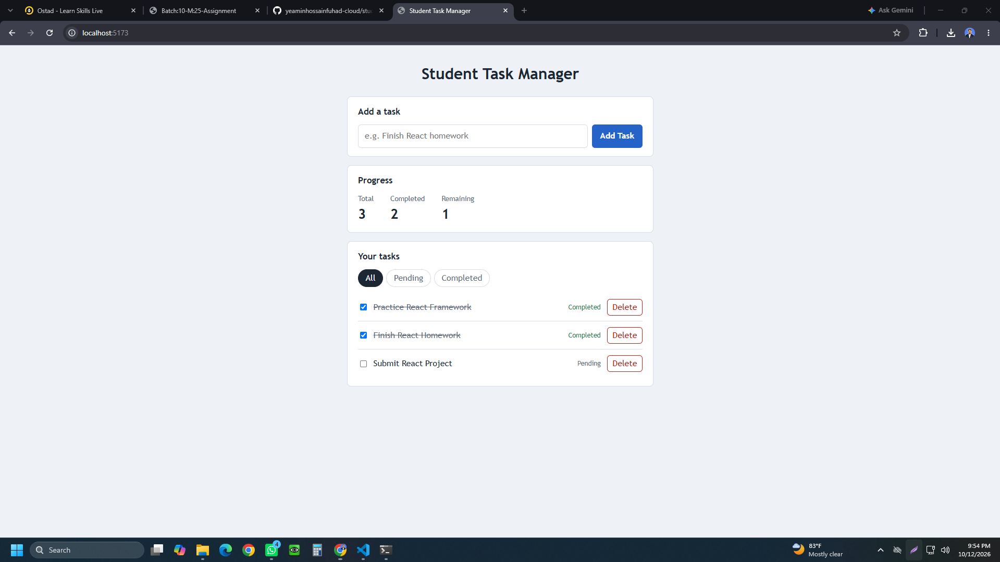
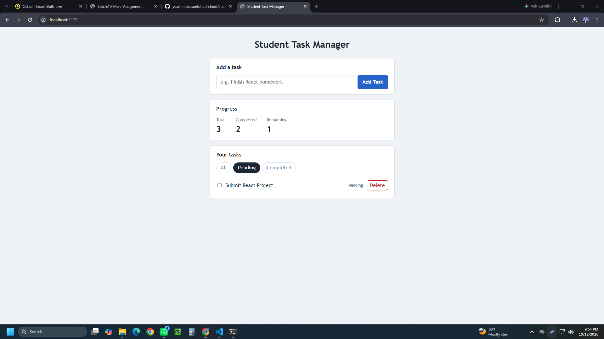
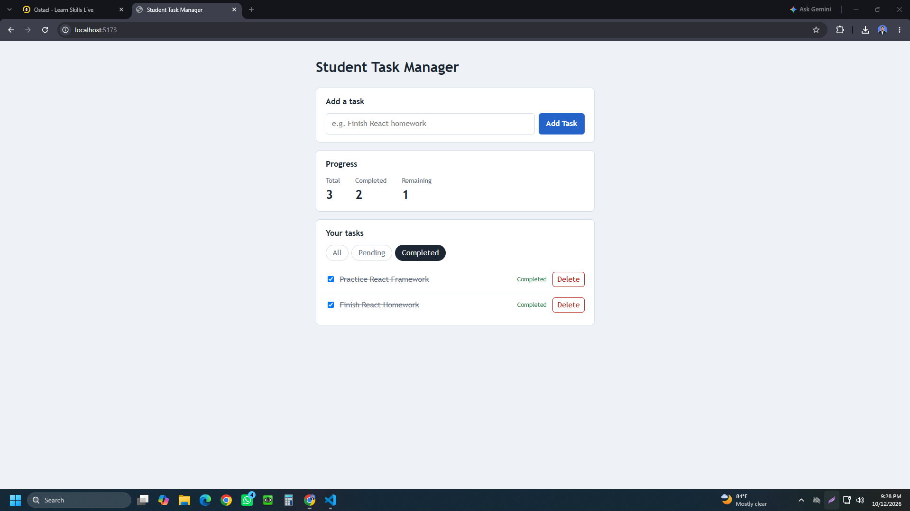
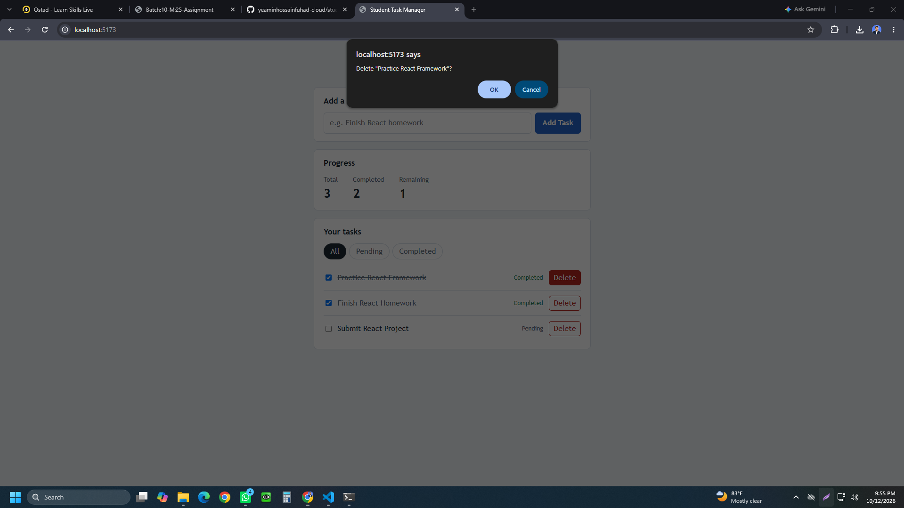
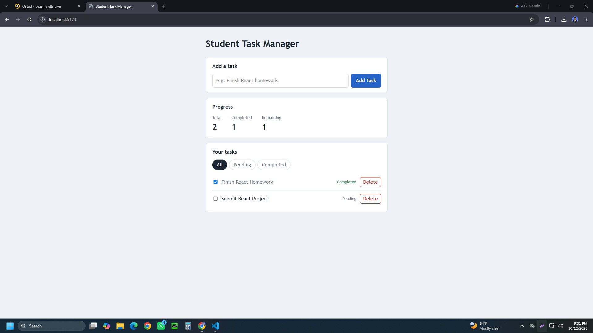

# Student Task Manager

A simple and interactive React application that helps students manage their daily tasks. Users can add new tasks, view their task list, mark tasks as completed, and delete tasks.

## 📌 Project Overview

**Project Name:** Student Task Manager

**Objective:** To practice React fundamentals, including components, JSX, conditional rendering, props, events, component composition, and error handling.

## ✨ Features

- **Display Tasks:** View all tasks with their titles and completion status.
- **Add New Task:** Add tasks using an input field and button.
- **Complete Tasks:** Mark tasks as completed using a checkbox or button.
- **Delete Tasks:** Remove tasks from the list.
- **Conditional Rendering:** Display "No tasks available" when the task list is empty.
- **Task Statistics:** View the total number of tasks and completed tasks.
- **Form Validation:** Prevent users from adding empty tasks.
- **Task Filtering:** Filter tasks by All, Completed, and Pending.
- **Responsive UI:** Use a clean and user-friendly interface.

## 🛠️ Technologies Used

- React.js
- JavaScript (ES6+)
- HTML5
- CSS3
- Vite (if used in the project)

## 📸 Screenshots

The following screenshots demonstrate the application's features.

### 1. Student Task Manager


### 2. Pending Tasks


### 3. Completed Tasks


### 4. Delete Task


### 5. Delete Confirmation / Additional View


## 🚀 Getting Started

Follow these steps to run the project locally.

### Prerequisites

- Node.js
- npm
- Git

### Installation

**1. Clone the repository**

```bash
git clone https://github.com/yeaminhossainfuhad-cloud/student-task-manager.git
```

**2. Navigate to the project directory**

```bash
cd student-task-manager
```

**3. Install dependencies**

```bash
npm install
```

**4. Start the development server**

```bash
npm run dev
```

**5. Open the application**

Open the local URL displayed in your terminal, usually:

```text
http://localhost:5173
```

## 📂 Project Structure

```text
student-task-manager/
├── public/
├── src/
│   ├── components/
│   ├── App.jsx
│   ├── App.css
│   ├── index.css
│   └── main.jsx
├── screenshot/
│   ├── completed.png
│   ├── delete.png
│   ├── delete1.png
│   ├── pending.png
│   └── student_task_manager.png
├── index.html
├── package.json
└── README.md
```

*Note: The structure may vary depending on your implementation.*

## 🎯 Learning Outcomes

Through this project, I practiced:

- Building reusable React components.
- Managing state and handling user events.
- Passing data through props.
- Implementing conditional rendering.
- Validating form input.
- Rendering dynamic lists using React.
- Creating an interactive user interface.

## 🔗 Repository

GitHub: [Student Task Manager](https://github.com/yeaminhossainfuhad-cloud/-student-task-manager)

## 👨‍💻 Author

**Yeamin Hossain Fuhad**

- GitHub: [@yeaminhossainfuhad-cloud](https://github.com/yeaminhossainfuhad-cloud)
- LinkedIn: [Yeamin Hossain Fuhad](https://linkedin.com/in/yeamin-hossain-fuhad/)

---

⭐ If you find this project helpful, feel free to explore the repository and share your feedback.
